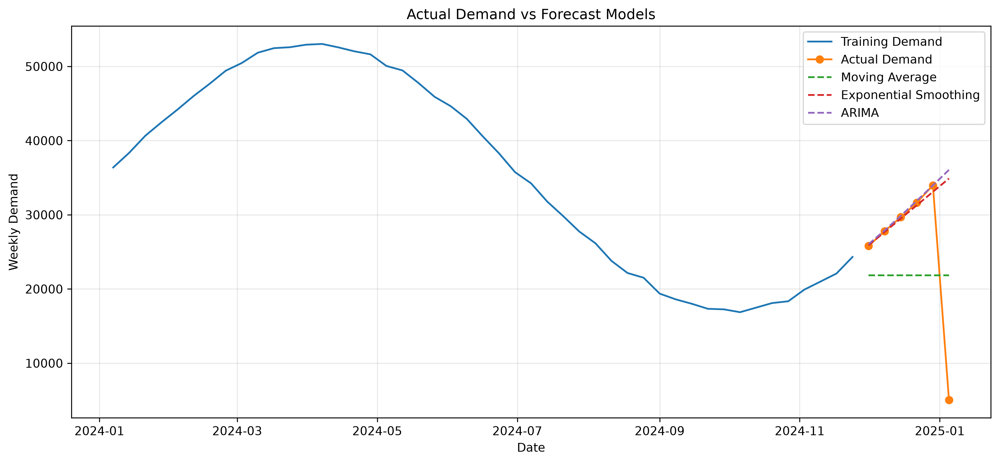
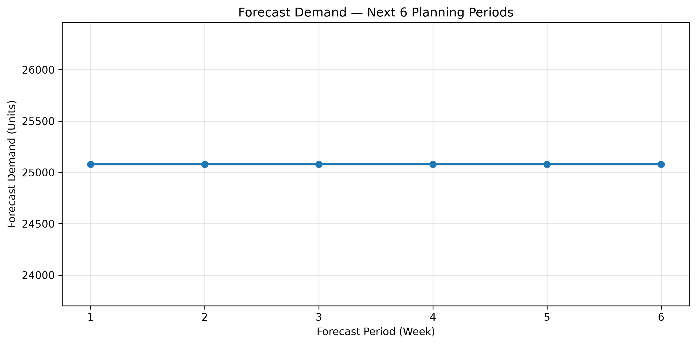
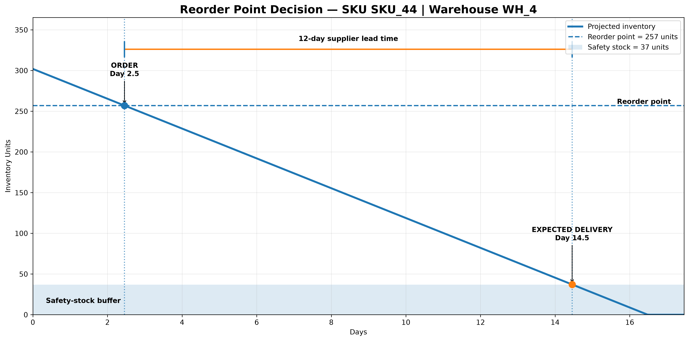
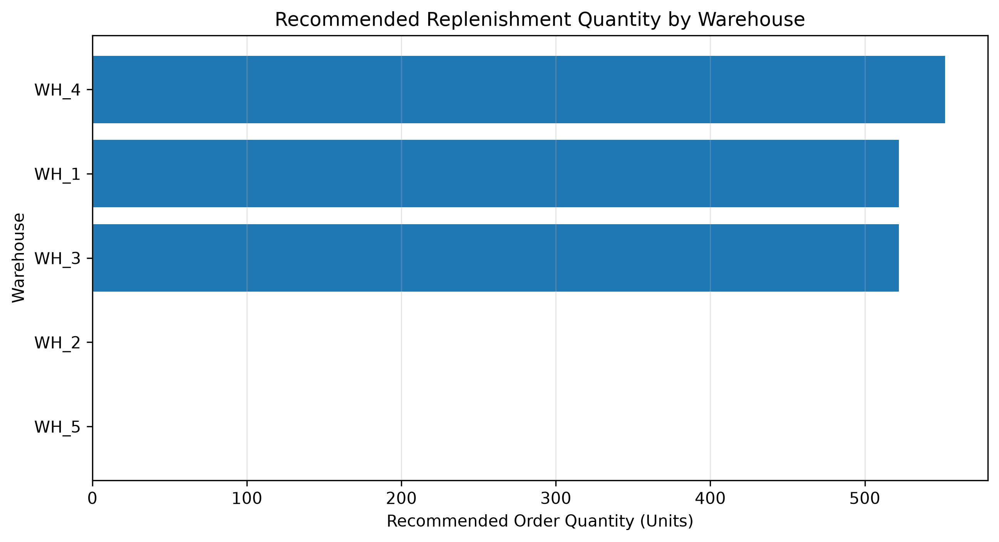
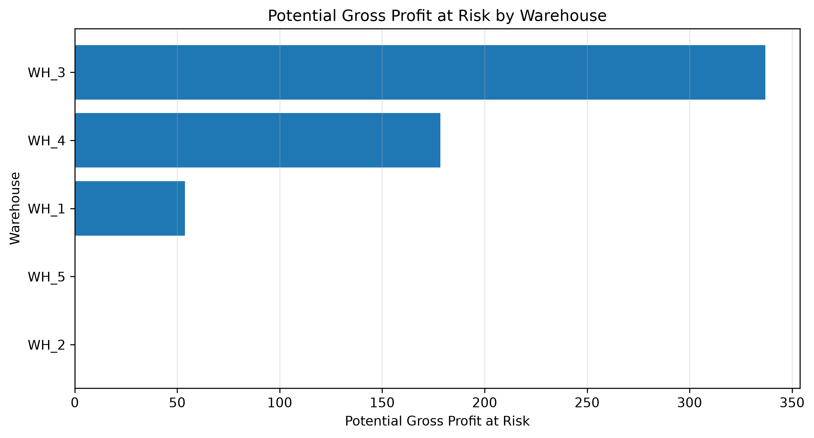
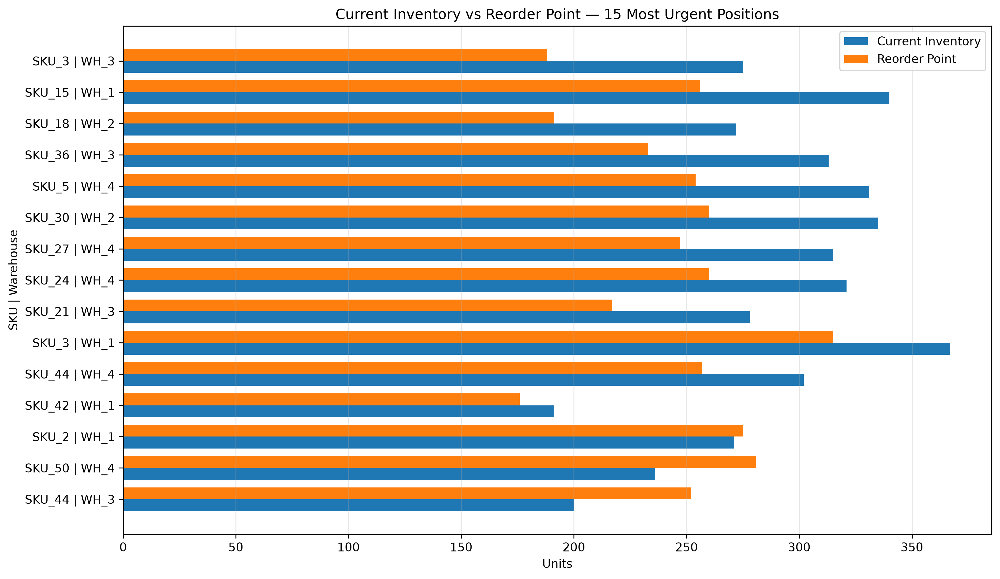

# Demand Forecasting & Inventory Optimization

## Project Overview

This project develops an end-to-end **supply chain analytics and inventory decision-support model in Python**. It combines historical demand analysis, time-series forecasting, safety-stock calculation, reorder-point logic, replenishment planning, warehouse prioritization, and financial-risk analysis.

The objective is not only to forecast demand, but to translate forecasts into practical procurement and inventory decisions:

> **What will demand look like, when should we reorder, how much should we order, and where should inventory action be prioritized?**

---

## Business Questions

The analysis addresses six core supply-chain questions:

1. What is expected demand over the next 1, 3, and 6 planning periods?
2. Which forecasting approach performs best on the holdout period?
3. When should each SKU–warehouse position be reordered?
4. How much inventory should be replenished?
5. Which warehouses require the most urgent replenishment attention?
6. What are the potential financial exposures from shortage risk and excess inventory?

---

## Dataset

The analysis uses daily supply-chain observations covering:

- **50 SKUs**
- **5 warehouses**
- **250 SKU–warehouse combinations**
- Demand, inventory, supplier lead time, unit cost, and selling-price information

The notebook aggregates daily demand into weekly planning periods for forecasting while retaining SKU–warehouse detail for inventory optimization.

---

## Analytical Workflow

```text
Historical Demand
        ↓
Exploratory Analysis
        ↓
Weekly Demand Aggregation
        ↓
Train / Test Split
        ↓
Forecasting Models
        ↓
Model Evaluation
        ↓
Future Demand Forecast
        ↓
SKU–Warehouse Demand Profile
        ↓
Safety Stock
        ↓
Reorder Point
        ↓
Recommended Order Quantity
        ↓
Warehouse Replenishment Priority
        ↓
Shortage & Financial Risk
        ↓
Excess Inventory / Working Capital
        ↓
Management Decision Model
```

---

## Forecasting Models

Three forecasting approaches were evaluated:

- Moving Average
- Exponential Smoothing
- ARIMA

Performance was assessed using **MAE, RMSE, and MAPE**.

| Model | MAE | RMSE | MAPE |
|---|---:|---:|---:|
| Moving Average | 9,426.50 | 10,322.35 | **77.45%** |
| Exponential Smoothing | **5,245.65** | 12,202.26 | 99.96% |
| ARIMA | 5,305.77 | 12,671.25 | 103.44% |

The notebook selects the **Moving Average** model using the lowest MAPE as the model-selection criterion. The relatively high error levels also indicate that the forecasting component should be treated as a baseline model rather than a production-ready forecasting engine.



---

## Demand Forecast

The selected model produced the following planning forecast:

| Horizon | Forecast Demand |
|---|---:|
| Next 1 period | **25,080 units** |
| Next 3 periods | **75,240 units** |
| Next 6 periods | **150,480 units** |

The six-period forecast is approximately **25,080 units per week** in the current model output.



---

## Inventory Optimization

### Safety Stock and Reorder Point

For each SKU–warehouse combination, the model calculates safety stock and a reorder point based on expected demand during supplier lead time.

The decision logic is:

```text
Reorder Point = Expected Lead-Time Demand + Safety Stock
```

This prevents replenishment decisions from waiting until inventory reaches zero.

A data-driven example from the analysis selected **SKU_44 at WH_4**:

| Metric | Result |
|---|---:|
| Current inventory | 302 units |
| Average daily demand | 18.32 units/day |
| Supplier lead time | 12 days |
| Safety stock | 37 units |
| Calculated reorder point | 257 units |
| Estimated order trigger | Day 2.5 |
| Expected replenishment arrival | Day 14.5 |



The illustration demonstrates how inventory is expected to decline toward the reorder point. Once the threshold is reached, replenishment should be triggered so that lead-time demand is covered while safety stock provides an additional buffer.

---

## Replenishment Recommendations

Across the **250 SKU–warehouse combinations** analyzed:

- **3 positions require reorder action**
- **1,596 units** are recommended for replenishment

Warehouse-level analysis identified **WH_1 as the highest replenishment priority**, followed by WH_3 and WH_4.

| Warehouse | Avg. Days Cover | SKUs Requiring Reorder | Recommended Order Units | Priority |
|---|---:|---:|---:|---:|
| WH_1 | 24.8 | 1 | 522 | **1** |
| WH_3 | 25.0 | 1 | 522 | **2** |
| WH_4 | 25.1 | 1 | 552 | **3** |
| WH_5 | 26.1 | 0 | 0 | 4 |
| WH_2 | 27.8 | 0 | 0 | 5 |



---

## Shortage and Financial-Risk Exposure

The model estimates potential exposure where available inventory may be insufficient to cover calculated lead-time requirements.

Current model results indicate:

- **Potential shortage exposure:** approximately **99 units**
- **Potential revenue at risk:** **2,024.09**
- **Potential gross profit at risk:** **569.12**

These values represent **modelled exposure**, not observed historical losses.



---

## Excess Inventory and Working Capital

The model also identifies inventory held above the defined demand-and-safety-stock requirement.

Current results indicate:

- **Excess inventory:** approximately **119 units**
- **Capital tied up in excess inventory:** **719.92**

This creates a second management objective alongside service availability: avoid both shortage exposure and unnecessary working-capital investment.

---

## Most Urgent Inventory Positions

The final inventory view compares current inventory against the calculated reorder point for the 15 most urgent SKU–warehouse positions.



Positions where current inventory approaches or falls below the reorder point require closer procurement attention because supplier lead time may reduce the available response window.

---

## Key Management Insights

The analysis converts demand data into actionable supply-chain decisions. The most important findings are:

- The current forecasting models provide a useful baseline, but forecast accuracy should be improved before production deployment.
- The model identifies only **3 of 250 SKU–warehouse positions** as requiring immediate reorder action.
- **1,596 units** are recommended for replenishment across those positions.
- **WH_1** has the highest warehouse replenishment priority based on the current decision logic.
- Potential shortage exposure is approximately **99 units**, representing **569.12 in potential gross-profit exposure**.
- Approximately **119 units of excess inventory** represent **719.92 of tied-up inventory capital**.
- Combining forecast information with lead time, safety stock, reorder points, and financial exposure provides a stronger decision framework than relying on demand forecasting alone.

---

## Tools & Technologies

- **Python**
- **Pandas** — data manipulation and aggregation
- **NumPy** — numerical calculations
- **Matplotlib** — visualization
- **Scikit-learn** — forecast error metrics
- **Statsmodels** — Exponential Smoothing and ARIMA
- **Jupyter Notebook** — analysis workflow
- **Git & GitHub** — version control and portfolio publishing

---

## Repository Structure

```text
Demand-Forecasting-Inventory-Optimization/
│
├── Data/
├── Images/
├── Outputs/
├── Demand_Forecasting_Inventory_Optimization.ipynb
├── README.md
├── requirements.txt
└── .gitignore
```

- `Data/` contains the source data used by the project.
- `Images/` contains exported analytical visualizations.
- `Outputs/` contains forecast and inventory-optimization outputs.
- `Demand_Forecasting_Inventory_Optimization.ipynb` contains the complete analysis and business interpretation.

---

## Limitations and Future Improvements

The current project should be viewed as a decision-support prototype. The forecasting errors remain relatively high, suggesting that demand contains variation not fully captured by the baseline models.

Future development could include:

- SKU-level forecasting instead of aggregate-only forecasting
- Seasonal SARIMA/SARIMAX models
- Gradient-boosting or other machine-learning forecasting approaches
- Promotion, price, holiday, and external-demand features
- ABC/XYZ inventory segmentation
- Dynamic service levels by SKU criticality
- Supplier-performance and lead-time variability modelling
- Backtesting inventory policies against historical demand
- Power BI or Streamlit deployment for interactive decision support

---

## Author

**John Wandera**  
Procurement & Supply Chain Professional | Supply Chain Analytics | Strategic Sourcing | Inventory & Demand Planning

---

## Project Purpose

This project was developed as a portfolio demonstration of how **Python analytics can connect demand forecasting with practical procurement, replenishment, inventory-risk, and working-capital decisions**.
